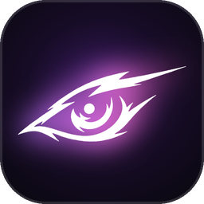
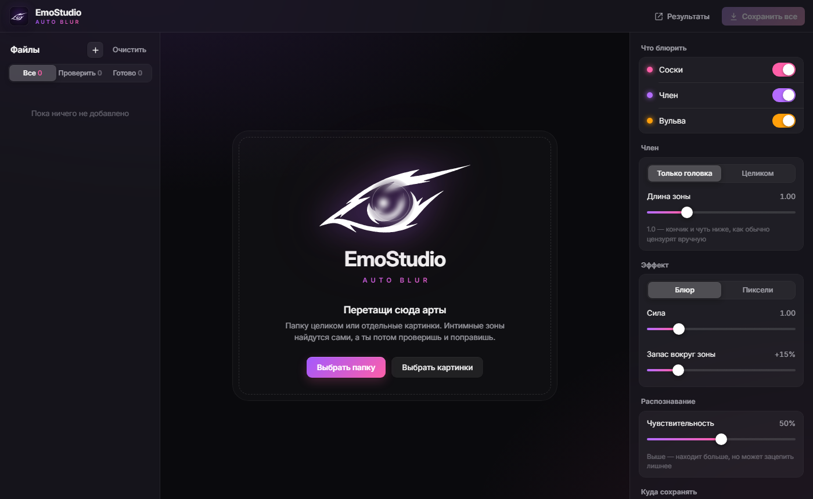

<p align="center">
  
</p>

<h1 align="center">EmoStudio Blur</h1>

<p align="center">
  <b>Автоматическая цензура артов.</b><br>
  Сама находит соски и головку члена, мягко их заблюривает и сохраняет копию. Можно целыми папками.
</p>

<p align="center">
  
</p>

---

## Содержание

- [Что умеет](#что-умеет)
- [Что нужно](#что-нужно)
- [Установка](#установка)
- [Как пользоваться](#как-пользоваться)
- [Редактор зон: управление](#редактор-зон-управление)
- [Настройки](#настройки)
- [Быстрый режим без окна](#быстрый-режим-без-окна)
- [Как это работает](#как-это-работает)
- [Советы](#советы)
- [Если что-то не работает](#если-что-то-не-работает)
- [Удаление](#удаление)
- [Структура проекта](#структура-проекта)
- [Благодарности](#благодарности)

---

## Что умеет

- 🔍 **Сама находит**, что нужно скрыть: соски, член и вульву. Модели обучены на рисованных артах, а не на фото.
- 🎯 **Блюрит только головку**: головку и чуть ниже, а не весь член с яйцами. Так обычно и цензурят вручную. Если нужно, можно включить режим «целиком».
- 📁 **Работает пачками.** Кидаешь папку на сотню артов, жмёшь «Сохранить все».
- ✋ **Можно поправить вручную.** Любую зону можно подвинуть, повернуть, растянуть, удалить или добавить новую. Блюр видно сразу, ещё до сохранения.
- 🛟 **Оригиналы не трогает.** Готовые копии ложатся в отдельную папку.
- ⚠️ **Подсказывает, что проверить.** Если программа не уверена (ничего не нашла или не смогла выделить головку), картинка попадает во вкладку «Проверить».
- 🌫️ Блюр с мягкими краями или пикселизация, сила регулируется.
- 🔒 **Всё работает у тебя на компьютере.** Картинки никуда не отправляются. Интернет нужен только при установке.

## Что нужно

| | |
|---|---|
| Система | Windows 10 или 11 (64-бит) |
| Python | 3.10–3.13. Если его нет, установщик предложит поставить Python 3.12 сам |
| Интернет | только при установке: библиотеки и модели распознавания, всего около 500 МБ |
| Место на диске | около 1 ГБ |
| Видеокарта | не нужна, всё считается на процессоре |

## Установка

1. **Скачай проект.** На странице GitHub: зелёная кнопка **Code → Download ZIP**, потом распакуй архив.
   Или через git:
   ```bash
   git clone https://github.com/<твой-ник>/emostudio-blur.git
   ```
2. **Положи папку туда, где она будет жить постоянно.** Например, `C:\EmoStudio Blur` или `D:\Programs\EmoStudio Blur`.
   Ярлыки будут указывать на это место. Если потом перенесёшь папку, просто запусти установку ещё раз.
3. **Запусти `install.bat`** (двойной клик). Откроется окно установки, и оно само:
   1. найдёт Python, а если его нет, предложит установить;
   2. создаст отдельное окружение `venv` внутри папки (в систему ничего не попадает);
   3. поставит библиотеки (самый долгий шаг, несколько минут);
   4. скачает модели распознавания;
   5. создаст ярлык **EmoStudio Blur** на рабочем столе и в меню «Пуск».
4. В конце установщик спросит «Запустить сейчас?». Нажми `Y` и `Enter`.

> 💡 Если Windows покажет «Windows защитила ваш компьютер», нажми **Подробнее → Выполнить в любом случае**. Так бывает с любыми скачанными `.bat`-файлами.

## Как пользоваться

1. **Открой программу** ярлыком **EmoStudio Blur** на рабочем столе. Можно и через `EmoStudio Blur.bat` в папке.
2. **Добавь арты.** Перетащи в окно папку или картинки либо нажми **Выбрать папку** / **Выбрать картинки** на стартовом экране.
   Чтобы докинуть ещё, когда список уже не пустой, нажми **+** рядом с заголовком «Файлы».
   Подпапки тоже подхватываются. Папки `censored` с прошлыми результатами программа пропускает.
3. **Подожди распознавания.** Каждая картинка в списке слева проходит статусы:

   | Статус | Что значит |
   |---|---|
   | ⚪ в очереди | ждёт своей очереди |
   | 🟣 распознаю… | нейросеть ищет, что скрыть |
   | 🩷 3 зоны | готово, найдено 3 зоны |
   | 🟡 ⚠ … | программа не уверена, стоит посмотреть самому |
   | 🟢 сохранено | копия уже лежит в папке результатов |
   | 🔴 ошибка | файл не открылся (битый или неподдерживаемый формат) |

4. **Проверь результат.** Кликай по картинкам в списке или листай стрелками `←` `→`. Удерживай `Пробел`, чтобы сравнить с оригиналом.
   Вкладка **Проверить** показывает только сомнительные картинки, их стоит глянуть в первую очередь.
5. **Поправь, если нужно** (управление описано ниже). Если что-то испортил, кнопка **Авто** вернёт автоматические зоны.
6. **Сохрани.** Кнопка **Сохранить все** сохраняет все готовые картинки разом, **Сохранить** внизу — только текущую (`Ctrl+S`).
7. **Открой результат** кнопкой **Результаты** вверху справа.

### Куда сохраняется

- По умолчанию копии кладутся в папку **`censored` рядом с оригиналами**. Структура подпапок сохраняется.
- В настройках справа (**Куда сохранять → Выбрать папку**) можно задать одну общую папку для всех результатов.
- Формат и имя файла остаются как у оригинала (`.png` → `.png`, `.jpg` → `.jpg`, `.webp` → `.webp`).
- Поддерживаются `png`, `jpg`/`jpeg`, `webp`, `bmp`.

> ⚠️ Прозрачный фон у PNG при сохранении заменяется белым.

## Редактор зон: управление

| Действие | Что делает |
|---|---|
| **Клик** по пустому месту | новая зона; если потянуть, задаёшь её размер |
| **Тащить** зону | двигать |
| **Тащить белый уголок** зоны | менять форму (овал); с `Shift` — ровный круг |
| **Колесо мыши** над зоной | увеличить или уменьшить |
| **Тащить кружок над зоной** (появляется у выбранной зоны) | повернуть; с `Shift` — шагами по 15° |
| `Shift` + колесо над зоной | повернуть на 5° |
| **Правая кнопка** или `Del` | удалить зону |
| `Пробел` (удерживать) | показать оригинал без блюра |
| `H` | спрятать или показать контуры зон |
| `Ctrl` + колесо | приблизить или отдалить картинку |
| Средняя кнопка мыши (тащить) | двигать приближенную картинку |
| Двойной клик по пустому месту | вернуть масштаб |
| `←` `→` | предыдущая / следующая картинка |
| `Ctrl+S` | сохранить текущую |

Цвет контура показывает, что это за зона: 🩷 сосок, 🟣 член, 🟠 вульва, 🩵 добавлена вручную.
При наведении видна подпись с уверенностью нейросети в процентах.

> Ручные правки защищены: если поменять настройки, картинки, которые ты правил руками, не пересчитываются. Чтобы применить к такой картинке новые настройки, нажми **Авто**.

## Настройки

Все настройки в правой панели. Они запоминаются между запусками.

| Настройка | Что делает | Совет |
|---|---|---|
| **Что блюрить** | какие части искать: соски, член, вульва | выключи то, что не нужно цензурить |
| **Член: Только головка / Целиком** | блюрить головку или весь член вместе с яйцами | «Только головка» — как на DeviantArt |
| **Длина зоны** | насколько далеко от кончика тянется зона (0.5–2.5) | 1.0 — головка и чуть ниже; больше — захватывает часть ствола |
| **Эффект: Блюр / Пиксели** | мягкое размытие или пикселизация | |
| **Сила** | насколько сильно размыто (0.3–4) | 1.0 — силуэт видно, детали нет; 2+ — почти пятно |
| **Запас вокруг зоны** | насколько расширить найденную зону | если блюр «не дотягивает» до краёв, увеличь |
| **Чувствительность** | насколько легко нейросеть «верит», что нашла | выше находит больше, но может зацепить лишнее (например, пупок) |
| **Куда сохранять** | своя папка или `censored` рядом с оригиналами | |
| **Сбросить настройки** | вернуть всё по умолчанию (папка сохранения остаётся) | |

## Быстрый режим без окна

Если проверять ничего не нужно, а надо просто прогнать папку:

1. Перетащи папку (или картинки) на **`Quick Blur - drop folder here.bat`**.
2. Подожди: в окне будет видно, что найдено на каждой картинке.
3. Результат появится в `censored` рядом с оригиналами. В конце будет список картинок, которые стоит проверить вручную.

Для продвинутых: запуск из командной строки с параметрами (из папки программы):

```bash
venv\Scripts\python src\autoblur.py "D:\Арты\Новые" --strength 1.5 --tip-size 1.2
```

| Параметр | По умолчанию | Что делает |
|---|---|---|
| `-o "папка"` | `censored` рядом | куда сохранять |
| `--full` | выкл. | член целиком, а не только головку |
| `--tip-size` | `1.0` | длина зоны головки |
| `--strength` | `1.0` | сила блюра |
| `--style blur\|pixel` | `blur` | блюр или пиксели |
| `--pad` | `0.15` | запас вокруг зоны (0.15 = +15%) |
| `--parts` | `nipples,penis,pussy` | что блюрить, через запятую |
| `--conf` | `0.3` | порог для сосков (меньше — находит больше) |
| `--conf-genitals` | `0.2` | порог для гениталий |
| `--debug` | выкл. | рядом сохранить картинки с контурами найденного |

> Быстрый режим использует свои параметры (выше), а не настройки из окна программы.

## Как это работает

1. **Поиск.** Две модели [`anime_censor_detection`](https://huggingface.co/deepghs/anime_censor_detection) из библиотеки [imgutils](https://github.com/deepghs/imgutils) (обучены на аниме и рисованных артах) ищут соски, член и вульву. Результаты обеих объединяются: одна часто находит то, что пропустила другая.
2. **Поиск головки.** Нейросеть выдаёт одну рамку на член вместе с яйцами. Внутри неё программа выделяет сам член (алгоритм GrabCut), находит два его самых дальних конца и берёт тот, что дальше от головы персонажа (голову ищет ещё одна модель). Это и есть головка.
3. **Блюр.** Вокруг найденных мест строятся овальные зоны с мягкими краями, и через них накладывается размытие или пикселизация.
4. **Проверка.** Если головку выделить не удалось, член блюрится целиком (лучше перестраховаться), а картинка помечается «⚠ проверь».

## Советы

- **Начни с вкладки «Проверить».** Обычно почти всё находится само, а вручную приходится смотреть только эти картинки.
- **Если блюр зацепил лишнее** (пупок, палец), поставь чувствительность пониже или удали зону правой кнопкой.
- **Если что-то пропущено**, подними чувствительность или добавь зону кликом.
- **Если головка видна из-под блюра**, увеличь «Длину зоны» или «Запас вокруг зоны».
- **Странные позы, сильные ракурсы, необычные цвета** — тут программа ошибается чаще, такие арты стоит глянуть глазами.
- **Большие пачки** обрабатываются примерно за 1–3 секунды на картинку, в зависимости от процессора.

## Если что-то не работает

<details>
<summary><b>Установщик пишет «Подходящий Python не найден»</b></summary>

Согласись на автоматическую установку (`Y`). Если не получилось, поставь Python 3.12 вручную с [python.org](https://www.python.org/downloads/). При установке **обязательно отметь галочку «Add python.exe to PATH»**. Потом снова запусти `install.bat`.
</details>

<details>
<summary><b>Ошибка на шаге «Ставлю библиотеки»</b></summary>

- Проверь интернет и запусти `install.bat` ещё раз: он продолжит с того места, где остановился.
- Если ошибка повторяется, удали папку `venv` внутри программы и запусти установку заново.
- Python 3.14 и новее пока не поддерживаются (не все библиотеки под него собраны). Поставь 3.12.
</details>

<details>
<summary><b>Не скачиваются модели</b></summary>

Модели качаются с huggingface.co. Если сайт у тебя недоступен, включи VPN на время установки. Модели сохраняются в `%USERPROFILE%\.cache\huggingface` и больше не скачиваются.
</details>

<details>
<summary><b>Окно программы не открывается (или открывается белым)</b></summary>

Программе нужен компонент Windows **Microsoft Edge WebView2**. В Windows 11 он есть всегда, а в Windows 10 его иногда нет. Скачай «Evergreen Bootstrapper» с [сайта Microsoft](https://developer.microsoft.com/microsoft-edge/webview2/) и установи.

Если не помогло, посмотри лог: `%APPDATA%\EmoStudio Blur\log.txt` (вставь этот путь в адресную строку Проводника).
</details>

<details>
<summary><b>Ярлык перестал работать</b></summary>

Скорее всего, папку программы перенесли или переименовали. Запусти `install.bat` из нового места, и он пересоздаст ярлыки.
</details>

<details>
<summary><b>Перетаскивание в окно не срабатывает</b></summary>

Если программа запущена от имени администратора, Windows не даёт перетаскивать в неё файлы из обычного Проводника. Запусти её обычным способом или добавь арты кнопками на стартовом экране или через **+** в списке файлов.
</details>

<details>
<summary><b>Хочу сбросить всё к заводским настройкам</b></summary>

Удали папку `%APPDATA%\EmoStudio Blur`, там хранятся только настройки и лог.
</details>

## Удаление

1. Удали ярлыки (из папки программы):
   ```bash
   venv\Scripts\python src\shortcuts.py --remove
   ```
2. Удали папку программы.
3. По желанию удали настройки `%APPDATA%\EmoStudio Blur` и модели `%USERPROFILE%\.cache\huggingface`.

## Структура проекта

```
EmoStudio Blur/
├── install.bat                        установка (запустить первым)
├── EmoStudio Blur.bat                 запуск программы
├── Quick Blur - drop folder here.bat  быстрый режим без окна
├── requirements.txt                   список библиотек
├── assets/                            иконка, логотип, скриншот
├── src/
│   ├── app.py                         окно программы
│   ├── censor_core.py                 распознавание и блюр
│   ├── autoblur.py                    быстрый режим (командная строка)
│   ├── shortcuts.py                   создание ярлыков
│   └── ui/
│       ├── index.html                 интерфейс
│       └── fonts/                     шрифт Inter и его лицензия
└── tools/setup.ps1                    сам установщик
```

Для разработки: если перед запуском `src\app.py` задать переменную окружения `EMOSTUDIO_DEBUG=1`, откроются инструменты разработчика.

## Благодарности

- [Claude](https://claude.ai) от Anthropic — помощь в разработке

---

<p align="center"><sub>EmoStudio · auto blur</sub></p>
